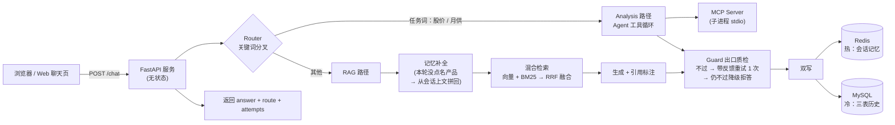

# FinAgent —— 可审计的财经问答 Agent

## 2026.10：公开语料多证据评测升级

新增独立实验模块 [`p1_public/`](p1_public/README.md)：整理 12 份中国银行公开产品页面，建立 66 题任务集（开发 30、保留 36），针对跨产品与多证据问题实现按产品和条件拆解检索、证据合并。相同 6 段证据预算下，保留集必要证据全部覆盖由 15/19 变为 19/19；字段、状态与引文的自动检查由 28/36 变为 34/36。完整口径、错例及限制见[实验报告](p1_public/REPORT.md)。

该模块有独立 FastAPI `/answer` 接口与测试；原有 `/chat` 服务和三份演示语料评测保留。新旧实验的题集与分母不同，不能将两组数字连成同一条提升曲线。

## 基础版服务

一个从零构建的贷款客服 Agent：基于三份贷款产品说明书（安居贷 / 乐享贷 / 兴旺贷），回答利率、额度、罚息等业务问题。

核心设计目标只有一个——**答案可查证**：

- 每句答案带 `[文档名 P页码]` 引用，引用由代码层白名单校验，编造即打回；
- 语料里没有的问题，拒答而不是编造（宁拒不错）；
- 每次改动用 18 题评测集回归验证，数字可复现。

<!-- 演示 GIF 录制后插入此处：

-->

## 架构

一条请求的一生：



## 评测（18 题，三层题型的双层计分）

评测集分单块（答案在 1 个 chunk）/ 多块（答案跨 3 个 chunk）/ 零块（语料外，考拒答）三类；检索层先考「golden 是否全进 top-3」，达标题再考生成层引用校验。全量明细见 `v3_eval_results.txt`。

| 指标 | 纯向量检索 | 混合检索（BM25 + RRF） |
|---|---|---|
| 检索命中率 | 11/16（69%） | **13/16（81%）** |
| ├ 单块题 | 10/11 | **11/11** |
| └ 多块题 | 1/5 | **2/5** |
| 引用白名单校验 | 11/11 | **13/13**（零编造） |
| 语料外拒答 | 2/2 | **2/2** |

升级动机是实测出来的：纯向量存在**语义盲区**（用户问「打折优惠」，语料写「下浮」，换回原词查询相似度反而全场最低）和**稀释**（500 字长块里 80 字相关，整块向量被冲淡）。BM25 认字面、向量认语义，两路各召回 top-10 后用 RRF 融排名回 top-3——融合排名不融合分数，因为余弦有界而 BM25 无界。

剩余未过的 3 题均为多块题，病因是稀释（块粒度问题，属于分块层，检索融合无法修复）——修复边界清晰，下一步方向是按语义小节切更细的块。

## 版本演进

每一版解决上一版暴露的问题：

| 版本 | 解决什么 |
|---|---|
| V1 | ReAct 基础循环：LLM + 工具调用（查利率、算月供），步数上限防死循环 |
| V2 | 结构化工具注册表 + 规范化输出，工具循环可控可审计 |
| V3 | RAG 闭环：语料按页分块 → 向量检索 → 生成 → 引用硬校验；18 题评测集 + BM25/RRF 混合检索 |
| V4 | 记忆与持久化：Redis 三 key 会话记忆 + MySQL 三表冷存储双写；MCP 工具接入 |
| V5 | 服务化：FastAPI + 重试护栏 + 校验-重试-降级 Guard 链 + Docker compose 一键真库全链路 + Web 聊天页 |

## 关键工程决策

- **引用白名单校验（宽进严出）**：宽正则抓出答案里所有疑似引用，逐个比对必须精确落在本次检索命中的真实 `(文档, 页码)` 集合内——判据是「值在真实来源里」，不是「格式看着像」。黑名单式校验只查认得的格式，认不得的漏过。
- **Guard 链：判据与机制解耦**：校验不过 → 失败原因注进 prompt 重试 1 次 → 仍不过降级拒答。RAG 路和工具路的判据不同，但「重试一次再降级」的机制复用同一套。重试必须带反馈——温度为 0 时输入不变输出就不变，不带反馈的重试只是把同一个答案再抄一遍。
- **手写 BM25，零检索依赖**：中文无空格用字符二元组切词（零依赖的最小解），k1 词频饱和 / b 长度归一 / IDF 稀有词加权。每个细节自己讲得清楚。
- **热冷双写**：Redis 管「这个会话刚聊了什么」（三 key：历史列表 / 用户画像 / 滚动摘要），MySQL 管「谁在什么时候说过什么」的关系查询（users / conversations / messages 三表，外键成树）。
- **无状态服务**：重资源（向量模型、矩阵、BM25 索引、DB 连接）在 lifespan 启动时加载一次；会话状态住在 Redis/MySQL 里，服务可横向扩。

## 运行

### Docker（一键真库全链路）

```bash
# 1. 准备 .env（DeepSeek API key）
echo "DEEPSEEK_API_KEY=sk-..." > .env

# 2. 准备本地模型（bind mount，不进镜像）
#    下载 paraphrase-multilingual-MiniLM-L12-v2 到 models/pmml12/（ModelScope 可取）

# 3. 起服务：Redis + MySQL + App 三容器，健康检查就绪后自动接线
docker compose up -d
# 浏览器打开 http://127.0.0.1:8000
```

### 本地开发（无 Docker）

```bash
pip install -r requirements.txt
python v5_app.py
# 本机没有 Redis/MySQL 时自动降级为进程内 dict + SQLite，代码路径不变
```

## 技术栈

Python · FastAPI · DeepSeek API · sentence-transformers · 手写 BM25 + RRF · Redis · MySQL / SQLAlchemy · MCP · Docker Compose
