# 2026 年华北五省（市、自治区）及港澳台大学生计算机应用大赛

## 移动互联网应用创新 —— 移动互联网应用程序开发

**【项目名称】"贷"你明白 FinAgent —— 可溯源、不编造的普惠金融问答助手**

（响应式 Web 作品 · 手机优先）

| 封面信息 | 填写 |
|---|---|
| 所在赛区 | 北京 |
| 所在学校 | 北京邮电大学 |
| 团队名称 | Better Call Me |
| 团队成员 | 文智杰（研发负责人）／文智豪（产品与呈现负责人） |
| 提交日期 | 2026 年 10 月 6 日 |

---

## 参赛作品知识产权声明

参赛作品名称：**"贷"你明白 FinAgent**（下称该作品）

本小组全体成员，就该作品声明如下：

1. 该作品（含提交参赛的 App 应用、相关文档和介绍视频）是本小组成员的原创研究成果，不存在侵犯任何他人知识产权、涉及泄密或违反中华人民共和国法律法规的情形，且未在【2026】年【11】月【30】日前公开发布。
2. 我们确认：该作品知识产权归本小组成员所有，且签署本声明的人员能够代表全体小组成员的意愿。
3. 我们承诺：将仅由本小组成员参加大赛答辩。
4. 大赛举办方为宣传大赛、推广参赛作品，以及为未来各届大赛的参赛选手提供参考等非盈利目的，可能需要以下列形式使用参赛作品，就此我们确认：
   （1）☑同意 □不同意：将参赛作品的相关文档结集出版（含公开发行）；
   （2）☑同意 □不同意：在相关网站（包括大赛官网及含优酷等第三方视频平台网站）上传和播放介绍视频或幻灯片；
   （3）☑同意 □不同意：在大赛官方网站提供 APP 应用免费下载；
   （4）作出上述许可，同样不违反本声明第 1 款的要求。

作品小组全体成员：文智杰　文智豪
日期：2026 年 10 月 6 日

---

## 目录

一、作品概述
二、作品可行性分析和目标群体
三、作品功能与原型设计
四、作品实现、难点及特色分析
五、团队介绍和人员分工
六、其他
七、致谢

---

## 一、作品概述

贷款是普通人一生中金额最大的决策之一，但贷款产品的规则——利率、首付、期限、申请条件——散落在几十页的产品文档里，术语晦涩（LPR、等额本息、征信查询次数），普通人读不动，也不敢只听销售的一面之词。直接问通用大模型？它会"一本正经地编造"：给出看似专业、实则虚构的利率和条款——这在金融场景是危险的。

本作品是一个面向贷款小白的 AI 问答助手，核心设计原则只有三条：

1. **只说有出处的话**：回答只基于真实贷款产品文档检索生成，每个论断附 `[文档名 页码]` 级引用，点击引用即可查看原文段落；
2. **答不了就明说**：每条回答经过出口校验，发现编造引用自动带反馈重试，仍不通过则明确拒答，绝不"硬答"；
3. **数字交给代码算**：月供、利率等计算走确定性工具路径，不让大模型做算术；「我该选哪款」的**适配测评**同样由规则代码打分——答 5 道选择题，毫秒级出一张每条结论附说明书引用的推荐卡。

系统已部署于公网（Docker 三容器架构），手机浏览器即开即用；回答全程流式输出（打字机效果）；请求量、双路径占比、护栏拦截情况、延迟等运行指标实时可观测——**用数字说话，而不是用形容词**。

## 二、作品可行性分析和目标群体

### （1）可行性分析

**技术可行性**：系统核心是"检索增强生成（RAG）＋工具调用＋出口校验护栏"的受控编排架构，全部核心组件自研实现（未依赖 LangChain 等重型框架），代码量可控、行为可解释。大模型采用国产 DeepSeek API，语义向量采用开源 sentence-transformers 模型本地推理，检索采用 BM25 关键词＋向量语义的混合检索。系统已于 2026 年 9 月部署至公网服务器，三容器（FastAPI 应用＋Redis＋MySQL）稳定运行，端到端问答验证通过，并以自建 18 题评估集验证回答质量（数字见四（1））。

**操作可行性**：无需安装 App，手机或电脑浏览器访问即用；中文自然语言交互；答案中的引用徽章一键点开原文，零学习成本。页面针对手机屏幕适配，单手可完成全部操作。

**经济可行性**：轻量云服务器月成本约几十元；大模型 API 按 token 计费，单次问答成本约几分钱；开源组件零授权费。作为对照，人工客服单次咨询成本以十元计。服务本身无状态（状态存于 Redis/MySQL），具备从小规模试用到机构部署的扩容演进路径。

### （2）目标群体

- **C 端**：首次接触贷款的年轻人——毕业生、首次购房者。他们对贷款术语完全陌生，最需要"人话解释"，也最怕被误导；
- **B 端**：银行／助贷机构的辅助客服（7×24 小时先答一轮，答不了的转人工），以及机构内部产品知识库问答；
- 用户特征（调研归纳）：
  1. 不懂术语，需要通俗解释，而不是复述合同原文；
  2. 最怕被误导，要求"每个说法有依据、能核对"；
  3. 以手机为主要上网设备，没有耐心为一次查询安装新 App。

## 三、作品功能与原型设计

### （1）功能概述

| 功能名称 | 功能描述 |
|---|---|
| 贷款规则问答 | 基于三份真实贷款产品文档（安居贷／乐享贷／兴旺贷）检索增强回答，答案附 `[文档 页码]` 级引用 |
| 引用溯源 | 点击答案中的引用徽章，侧滑面板显示对应原文段落——防幻觉"可验证、可点开" |
| 多产品对比 | 对比类问题走专用路径（如“安居贷和乐享贷的申请条件区别”；不点名的“这几款哪个年龄限制更宽松”同样支持）：每款产品独立检索、结构性保证双侧（三侧）覆盖，逐维度对照表渲染、每格带引用；检索未覆盖的字段如实标“未检出”——缺证据不等于证据缺失，绝不编造 |
| 贷款适配测评 | 引导式问卷（用途/年龄/期限/金额，经营用途自动追加条件题）→ **规则代码确定性打分**（硬门槛定资格、软评分排座次，全程零大模型调用）→ 推荐卡：首选产品匹配度 + 推荐理由/注意事项逐条挂引用 + 按说明书公式现场估算月供；三款均不适合时诚实全拒并逐款说明原因 |
| 行情与计算问答 | 股价查询、月供/利率计算等走工具调用路径，数字由确定性代码计算，不靠模型口算 |
| 用户画像·"它记得我" | 🧠 面板可查看/编辑长期画像（住房套型、意向产品、预算区间，白名单校验），改画像后下一轮回答**行为可见变化**：画像"二套"时问"安居贷利率多少"答 4.45%，改成"首套"再问同一句答 3.95%——记忆真在被检索消费，不是摆设 |
| 会话恢复 | 刷新页面对话不丢：会话历史存服务端（Redis），重开页面自动回放（引用徽章照常可点）；「🆕 新对话」轮换会话但**跨会话画像保留**——会话级短记忆与长期画像两级分界清晰 |
| 多轮追问 | 会话级记忆 + 跨会话画像三级补全：用户没点名产品时，本轮点名优先，其次还原上文提过的产品（"它的首付"→上文产品），上文没有再由长期画像的意向产品兜底——新会话冷启动也记得"我想问乐享贷"。长对话滚动摘要：历史到 8 条自动把最旧 4 条压成要点摘要再裁剪（摘要跨会话保留），"记得住的"不随对话变长而无限膨胀 |
| 出口护栏 | 每条回答出口校验：引用必须落在本次检索命中的真实页码内；违规 → 带反馈重试 → 仍不过 → 红卡拒答 |
| 流式输出 | 打字机式逐字呈现，首字延迟约 0.8 秒（实测），交互体验对齐主流 AI 产品 |
| 运营看板 | `/stats` 可视化看板页（09-23 上线）：总请求、服务运行时长、平均/最大延迟、三路径占比（检索/对比/工具）、测评次数、护栏三档实时呈现，5 秒自动刷新；底层 `/metrics` 提供 JSON 原始数据，两端口径一致 |
| 健康自检 | 页面角标实时显示 Redis/MySQL 连接状态，存储降级透明可见而非静默 |

### （2）原型设计

- 实现平台：响应式 Web（单文件 HTML/JS 前端 + FastAPI 后端），手机优先适配；深色/浅色双主题（🌙 一键切换，聊天页与看板页同源同步）、消息入场与交互动效（尊重系统减弱动效设置）
- 运行环境：任意现代浏览器；公网地址 `http://47.95.222.61:8000`
- 界面截图与说明（图 1–图 8 为 2026-10-04 公网实机手机截图；图 9 为系统架构图，自绘，见"四、作品实现"节）：

> **图 1 主对话界面**：聊天气泡式交互，顶部角标实时显示后端真库/降级状态（Redis ✓ MySQL ✓）；快捷问题按钮一键提问。本图问句"安居贷的申请条件是什么"，回答附绿色引用徽章 `[anju_loan P1]`。
>
> 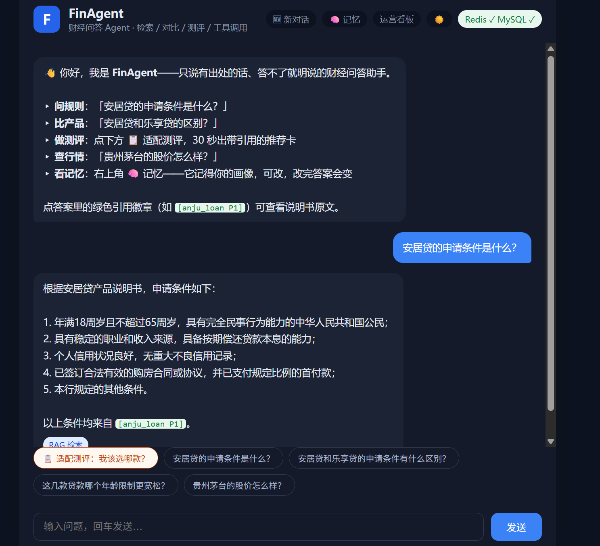
>
> **图 2 引用溯源面板**：点击答案中的绿色引用徽章（如 `[anju_loan P1]`），右侧滑出原文面板，显示该页真实文本段落——用户可当场核对，杜绝"AI 说了什么无从查证"。
>
> 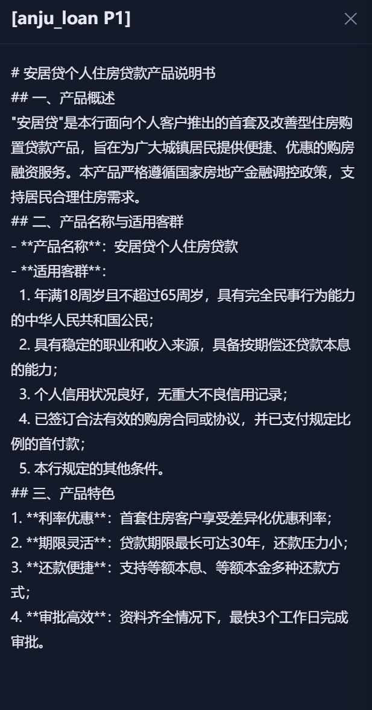
>
> **图 3 多产品对比表**：对比类问题走专用路径（本图："安居贷和乐享贷的申请条件有什么区别"）——每款产品独立检索、结构性保证双侧覆盖，逐维度对照表渲染、每格带引用徽章；检索未覆盖的字段如实标"未检出"——缺证据不等于证据缺失，绝不编造。
>
> 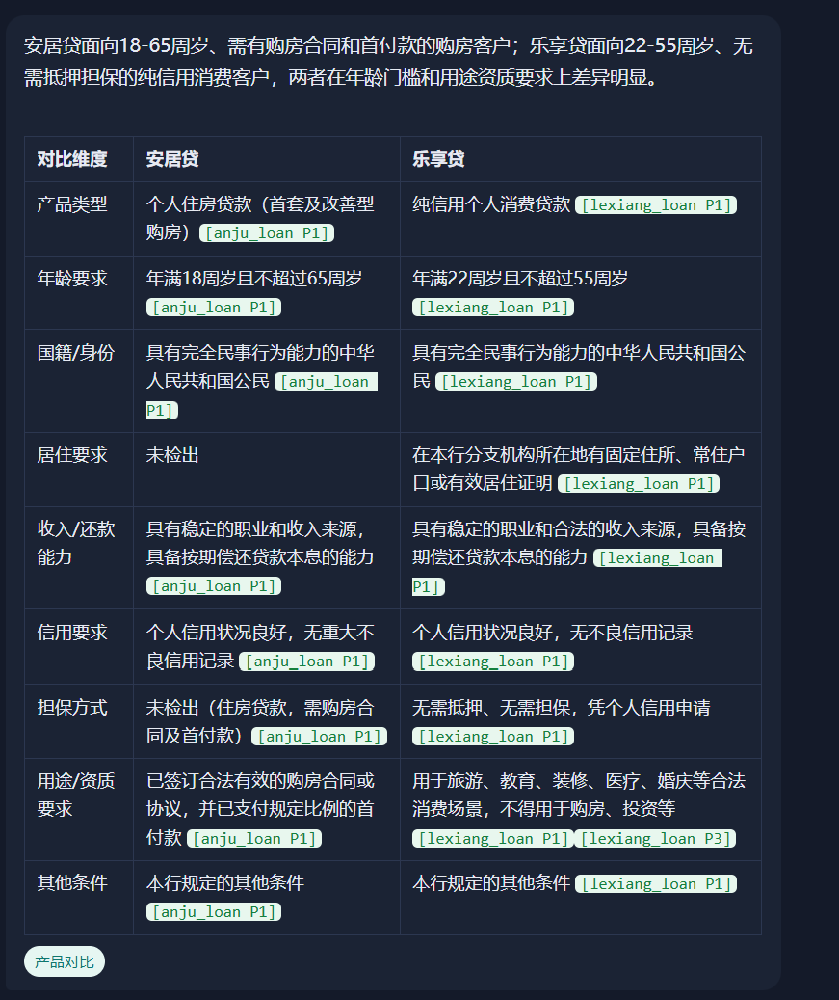
>
> **图 4 拒答红卡**：出口校验未通过且回滚重试仍失败时，回答替换为醒目的红色拒答卡片并说明原因；重试过的回答会标注"校验重试 ×1"徽章——护栏行为对用户透明。本图例：语料未涉及的公积金问题——如实回答"说明书里没有相关说明"，并给出可回答的追问建议。
>
> 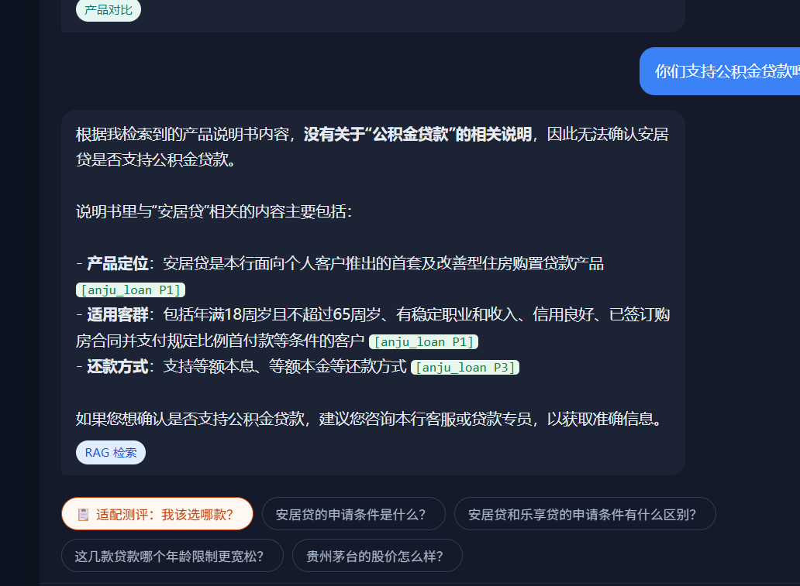
>
> **图 5 适配测评——诚实全拒**（`/` 点「📋 适配测评」）：问卷答完毫秒出卡，规则代码确定性打分、全程零大模型调用。本图例画像（消费用途／56-60 周岁／3-5 年／10-20 万）三款均不适合——系统不硬推，逐款给出被哪条条款拦下（住房购置贷款不适用一般消费 `[anju_loan P1]`、年龄超上限 `[lexiang_loan P1]`、仅限生产经营用途 `[xingwang_loan P1]`），并建议转人工。匹配时同一引擎输出首选匹配度、逐条挂引用的推荐理由与月供估算（见演示视频镜头 1）——推荐与拒绝同一引擎，宁拒不错。
>
> 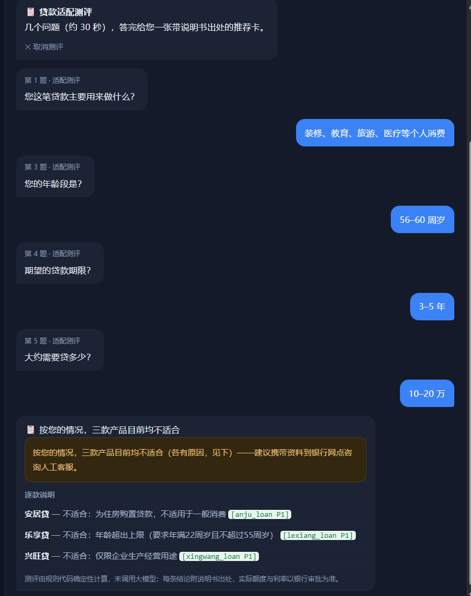
>
> **图 6 运营看板**（`/stats`，聊天页右上角一键进入）：总请求/运行时长/延迟数字卡 + 三路径占比 + 护栏三档占比，5 秒自动刷新。本图（10-04 实机）：总请求 28、运行 1 天 23 时、平均 1.62 s／最大 3.73 s、测评 3 次；路径占比 检索 21（75%）· 对比 5（18%）· 工具 2（7%）；护栏 一次通过 28（100%）· 重试 0 · 拒答 0。
>
> 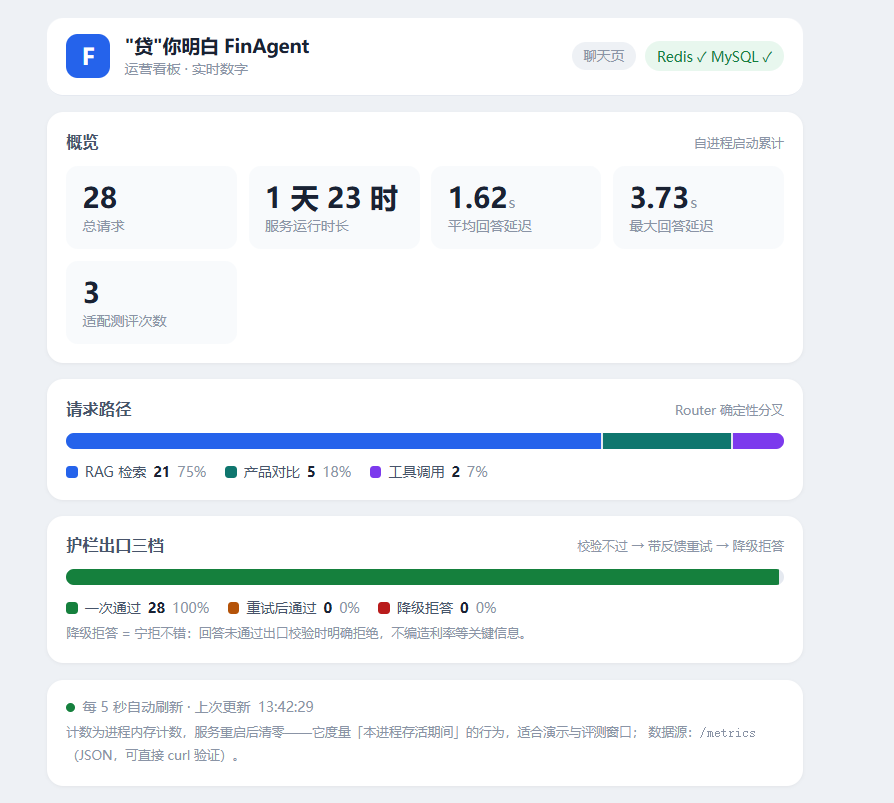
>
> **图 7 记忆面板"它记得我"**（`/` 点「🧠 记忆」）：上半是本会话快照（消息数、提过的产品），下半是跨会话画像（套型/意向产品/预算）——可编辑、白名单校验。演示动线（图 7 → 图 8）：保存"首套"画像前问"安居贷的利率是多少"，回答按说明书给全口径基准利率（首套 3.95%／二套 4.45%，图 8 上）；面板将套型改为"首套"保存，提示"已保存——下一轮问答立即生效"；再问同一句，回答按首套口径 3.95%（图 8 下，各带 `[anju_loan P2]` 引用）——记忆真在被检索消费，不是摆设。
>
> 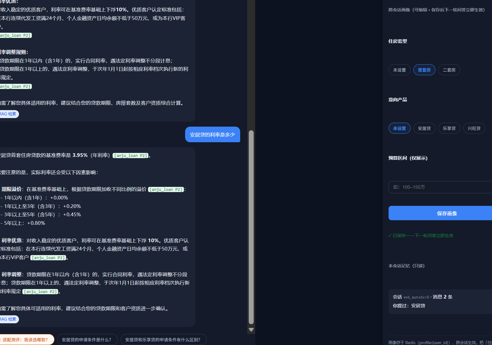
>
> **图 8 深色/浅色双主题**：🌙 一键切换，同一问句两种主题对照——上（深色）：保存画像前，全口径基准利率回答；下（浅色）：保存"首套"画像后同一问句，3.95% 首套口径回答。主题选择同源共享——聊天页切主题后打开 `/stats` 看板自动同款（图 6 看板即浅色主题）。
>
> 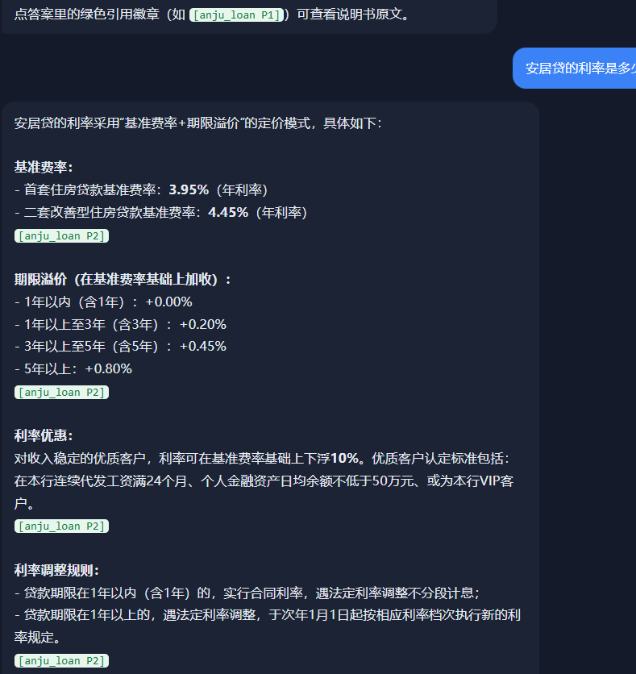
>
> 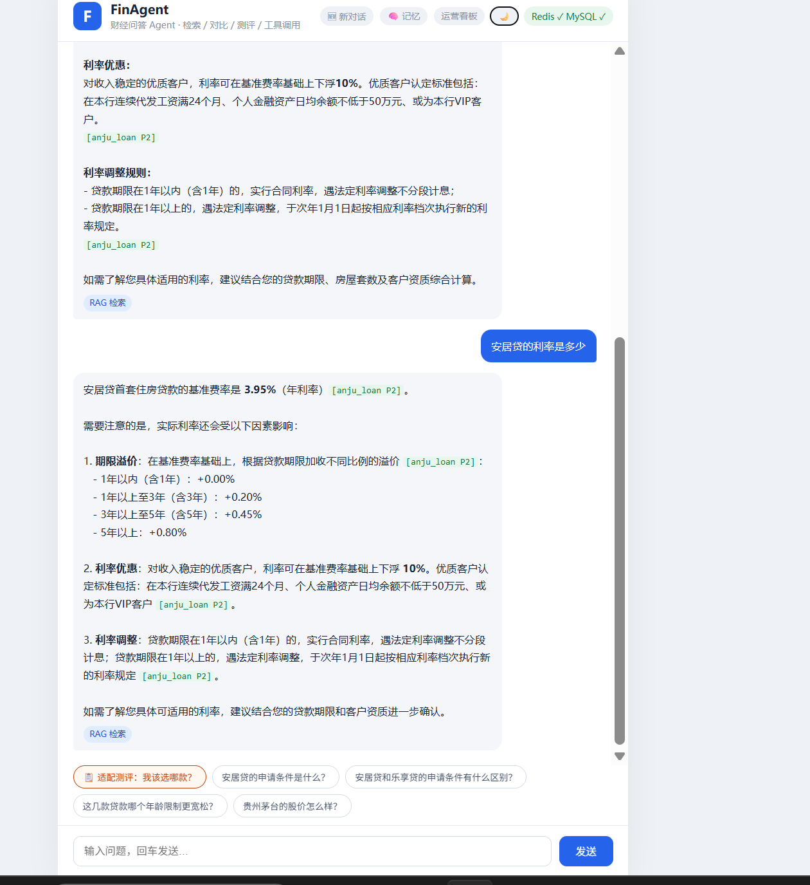

## 四、作品实现、难点及特色分析

### （1）作品实现及难点

**总体架构（受控编排）**：见图 9。用户消息先经 **Task Router**（确定性关键词规则）分流——产品规则类问题进入 **RAG 路径**（混合检索 → 生成 → 页号引用），行情/计算类进入**工具调用路径**（Agent 工具循环）；两路输出统一经过 **Validator 出口校验**，通过才返回用户。Agent 的自主性被限制在路径内部的局部节点——"Workflow 提供边界，Agent 在边界内自主"。这是对幻觉与失控风险的系统性防治，而不是提示词层面的恳求。

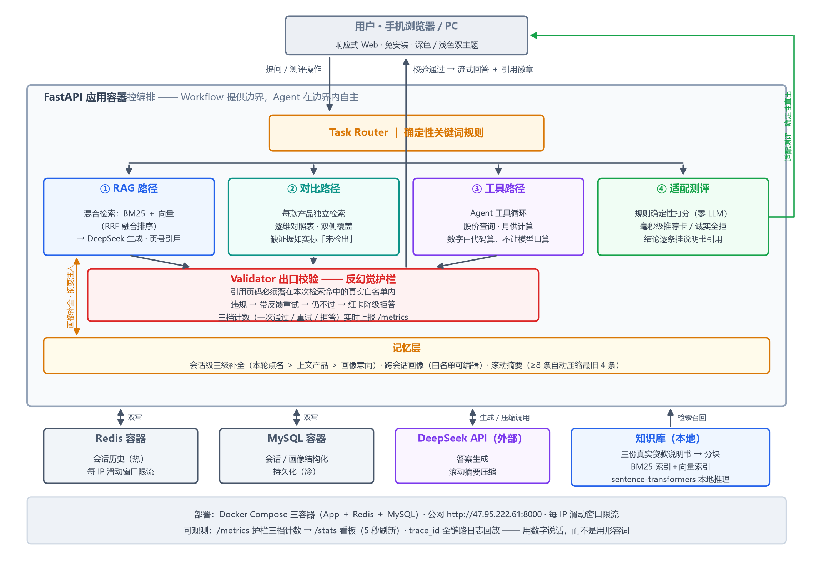

**难点 1：幻觉防治。** 大模型可能编造不存在的利率，或引用不存在的页码。本作品采用三道防线：① 检索白名单——生成时只喂真实文档块，引用校验只认本次命中块的真实页码；② 带反馈重试——校验不过时，把具体问题（如"引用页码 P9 不存在"）回喂模型重新生成，而非盲目重掷；③ 降级拒答——重试仍不过则返回标准拒答话术并转人工建议。三档行为（一次通过/重试后通过/降级拒答）在 `/metrics` 实时计数，可量化、可审计。

**难点 2：检索质量。** 纯向量检索对产品名等关键词不敏感（"安居贷"被语义淹没）。本作品实现 BM25 关键词检索与向量语义检索的**混合检索**（RRF 融合排序），关键词精确命中与语义泛化两者兼得。自建 18 题评估集（单块/多块/零块三类）于 09-29 全量复跑：混合检索较纯向量，检索命中率 **11/16 → 13/16**（翻绿的 2 题均为产品名关键词敏感题），单块题 **11/11** 满绿；检索达标题的生成层引用校验 **13/13** 全过——检索到就不编造；零块题（语料不含答案）拒答 **2/2**。对残留错误已做归因分析：主要来自分块稀释而非语义模型能力，对应改进路径（embedding 针对性微调）已列入展望——**知道错在哪，比全对更可信**。

**难点 3：流式输出与出口校验的矛盾。** 校验需要完整答案，流式要求边生成边输出——两者天然冲突。本作品的方案：首轮边流边攒（用户即时看到打字机效果），攒完整体校验；校验不过则推送 `retry` 事件，前端清屏后带反馈重发；仍不过则推送拒答文案。实测单次回答：首字延迟 0.76 秒、总耗时 2.6 秒、103 个增量片段——**体验不让步，质量也不让步**。

**难点 4：状态与持久化。** 会话记忆采用 Redis（热，毫秒级读写）与 MySQL（冷，结构化持久）双写；服务进程本身无状态，可横向扩容。长会话采用滚动摘要而非无限堆积：历史超过窗口阈值即把最旧一段压缩为要点（LLM 压缩，失败降级不影响当轮回答），近窗口保真、远期保梗概。配置密钥全部走环境变量，代码仓库不含任何密钥。公网服务自带每 IP 滑动窗口限流（对话 20 次/分钟、测评 60 次/分钟，429 带 Retry-After）——访问日志显示云厂商扫描段持续敲门，无鉴权的演示服务靠这层闸门防止接口被刷、API 额度被烧。检索侧建立了"假设-闸门-回滚"实验纪律：候选优化先过全量评测（翻红即回滚），一次同义扩展实验被闸门证伪后回滚留档，负结果与根因归因（查询稀释）均写入技术文档。

**难点 5：真实生产事故——隔夜陈旧连接。** 系统公网上线后的次日首个请求暴露 "MySQL server has gone away"：MySQL 服务端按超时策略关闭了闲置连接，而应用侧连接池仍持有失效连接。修复采用连接池保活两件套：取用前预检（pool_pre_ping——发现死连接自动丢弃重连）＋定时换新（pool_recycle——主动更换，抢在服务端超时之前）。该问题在本地短会话测试中永远不会出现，只有真实部署、真实闲置才会暴露——这也是本作品坚持公网上线而非单机演示的价值之一。

**工程化**：每次请求分配 trace_id 贯穿全部日志（一条请求的一生可完整回放）；`/metrics` 提供运行指标；部署采用 Docker Compose 一键拉起三容器，更新走"git → 服务器 → 容器重建"流水线，分钟级发布。

### （2）特色分析

- **特色 1｜每句话可溯源**：引用不是装饰，是可点击的承诺——点开即原文，用户从"相信 AI"变成"自己核对"；
- **特色 2｜宁拒不错**：拒答红卡与重试徽章让护栏行为用户可见。"答不了的诚实说"在金融场景是功能，不是缺陷；
- **特色 3｜全链路可观测**：请求量、路径占比、护栏三档、延迟，实时数字对齐生产级工程实践——学生作品里少见的"运维视角"；
- **特色 4｜完整迭代史**：从需求、架构、后端、前端、部署到评测全流程走通，V1→V5 五个大版本迭代、56 次 git 提交（原型仓库 24 次＋冲刺仓库 32 次），每次提交对应一个可验收的变更（下图截自两个仓库的提交历史）——真实的研发过程，而非一次性堆功能。

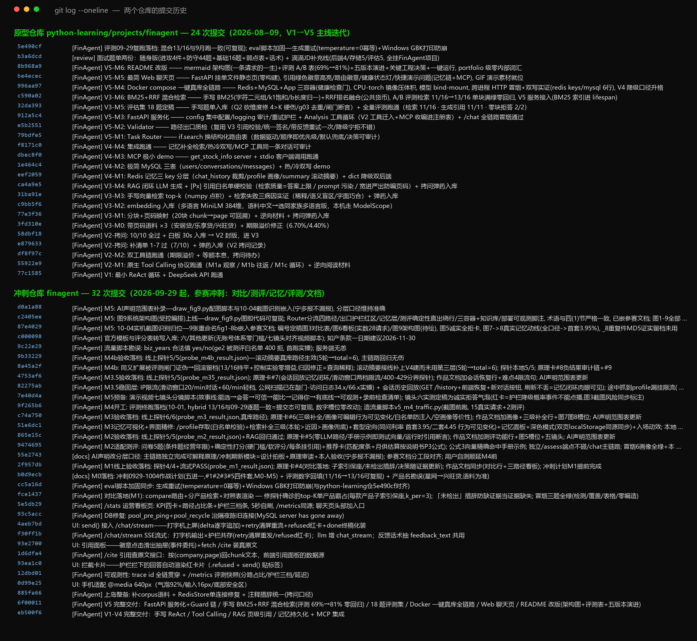

## 五、团队介绍和人员分工

| 所在学校 | 北京邮电大学 |
|---|---|
| 团队名称 | Better Call Me |
| 成员 A｜研发负责人　文智杰 | 需求分析与系统设计；后端与前端全部开发（RAG 检索／工具调用／出口护栏／记忆／流式输出）；自建 18 题评估体系；公网部署与运维 |
| 成员 B｜产品与呈现负责人　文智豪 | 市场调研与竞品分析；目标用户场景梳理；演示视频策划与制作；答辩材料与现场汇报；文档排版与校对 |
| 指导教师 | 无 |

两人双线并行：A 以版本迭代节奏推进系统（V1→V5，每版设验收门），B 以市场与用户视角产出调研数据与呈现物，按里程碑对齐合并。开发过程采用"AI 辅助编程"模式（详见附件《AI 使用声明》）：主链路（路由 / 检索 / 生成护栏 / 记忆 / 部署）由研发负责人独立实现；部分前端及冲刺期新增功能模块由 AI 辅助生成，设计经本人拍板、原理经本人审读、验收由本人执行后采用。

## 六、其他

- **公网访问**：`http://47.95.222.61:8000`（建议评审使用手机或电脑浏览器直接访问；页面顶部角标可确认后端状态）；运营看板 `http://47.95.222.61:8000/stats`（聊天页右上角"运营看板"一键进入）
- **无需注册登录**：作品不设账号密码体系，评审零门槛直连即可体验全部功能；用户画像与会话记忆按浏览器本地标识自动隔离，互不干扰
- **演示视频**：2–3 分钟，七个关键镜头——适配测评出推荐卡（推荐理由引用可点 + 月供估算）、流式打字机输出、引用点开看原文、多产品对比表、记忆面板改画像行为变化、诚实拒答（语料未涉及不编造）、运营看板数字
- **附件**：《AI 使用声明》、评测原始数据（18 题双层计分可复现）、系统架构图
- **代码**：如评审需要，可提供只读代码副本

## 七、致谢

感谢 DeepSeek、FastAPI、sentence-transformers 等开源开放社区。
